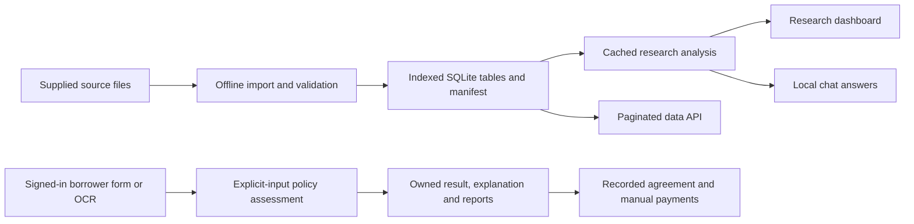

# Presentation outline and viva preparation

Use this as slide content and speaker notes. Replace the team fields with genuine names and responsibilities. Numerical values below come from `data/research_summary.json` and `data/source_manifest.json`; recheck them after any rebuild.

## Slide 1 — Problem and scope

**Title:** Analyzing Microloan-Related Data Using NLP and Clustering

**Subtitle:** Phase 2 extension of the PP1 loan-advisory prototype

- Small enterprises face different financial needs, cash-flow patterns and nonfinancial barriers.
- We combine structured data with available text to describe borrower groups and loan outcomes.
- Our current evidence is exploratory; household poverty reduction has not been measured.

**Say:** “The topic motivates poverty-alleviation research. Our implementation contributes a reproducible analytical workflow and an improved application. We distinguish that software contribution from a completed impact evaluation.”

## Slide 2 — What Phase 1 already contained

- Borrower application and description input, with optional OCR.
- Rule-based installment, affordability and business projections.
- Optional sentiment, keywords, clusters, topics and reports.

**Say:** “We retained this baseline. The audit found no chat API/database and found repeated data/model work on submission. Some analytics constructed borrower features or mixed incompatible indicators, so those were unsuitable research evidence.”

## Slide 3 — Data and provenance

- Show the manifest and dataset explorer.
- Distinguish Indian farm/dairy/price context from the accepted-loan archive's source population and currency.
- Show imported counts, missing narrative coverage and any sampling cap.

**Say:** “Integration does not mean these are matched borrowers. We analyze genuine linked fields within each source and do not join unrelated people by row order.”

## Slide 4 — System architecture

**Say:** “The interactive path reads bounded or cached results. Importing a large source or fitting a model is a separate operation.”

## Slide 5 — Methods

- Text preprocessing and TF-IDF identify discriminative terms.
- KMeans groups records using amount, income, rate, debt-to-income ratio and term; outcome and sentiment fields are excluded from clustering inputs.
- Silhouette evaluates internal separation for candidate cluster counts.
- Five-component NMF of TF-IDF describes recurring themes; heuristic sentiment describes tone.
- Observed outcome cohorts are compared within a clearly defined source and denominator.

**Show:** Feature definitions and candidate scores in the research result artifact. Explain every selected feature in ordinary language.

## Slide 6 — Results and interpretation

- Show imported row counts and data-quality coverage.
- Show selected cluster count and silhouette, then cluster sizes and characteristic attributes.
- Compare observed outcomes by group and term/rate bucket.
- Show one topic and its words, one narrative coverage caveat and one actual limitation.

**Results for this build:** 12,000 sampled loans from 2,260,668 eligible records; 7,029 resolved outcomes, 79.8976% fully paid; selected k=2 with silhouette 0.30539; 600 qualifying narratives. The two segment sizes are 3,533 and 8,467. All 600 narratives are resolved historical loans, so text coverage introduces a cohort-selection limitation.

**Say:** “These are associations in the available sample. Cluster numbers are identifiers, and a low/high outcome proportion is not a validated prediction for the next applicant.”

## Slide 7 — Performance and reliability

- Reusable data/model outputs are cached.
- Database queries have indexes and bounded connection reuse.
- The interface requests large records in pages and loads noncritical work when needed.
- Chat uses local evidence without an external model round trip.
- PDF generation is requested on demand.

**Show:** Measured timings and passed validation checks, identifying machine/environment and warm/cold measurements. Do not invent a Phase 1 chat speedup because Phase 1 had no chat API.

**Measured workload:** use the current `performance_results.json` and `validation_report.md`. Explain first-call versus warm requests and the authenticated saved-submission redirect. Do not quote the older anonymous-submission benchmark as the current workflow. Local request timings exclude browser/network, OCR and PDF work.

## Slide 8 — End-to-end demonstration

1. Open the landing page and explain the research and personal-application workflows.
2. Register/sign in. Use fictional details and the milk-business request for INR 10,000 in Bengaluru; enter a requested term, monthly income and current installment commitments.
3. Show that business revenue and surplus are unavailable without explicit monthly sales **and** costs. Read the configurable policy, selected term and rule-by-rule result.
4. Open Explanation and distinguish user-entered, narrative-extracted and policy-default values. Show actual source counts, price units and state/city match scope.
5. Download the PDF and JSON; sign out/in and reopen the saved record from My applications. Explain account ownership.
6. On a clearly labeled demonstration record only, record a fictional disbursement and payment. Show its ledger; explain that real use requires entries for events which occurred and that no funds move or bank verification occurs.
7. Explore the same purpose in Research and browse business datasets. Show the 12,000-row sample, original source population, converted INR display, topics and resolved-outcome definition.
8. Ask chat about the saved assessment, EMI, payment recording and poverty limitations. Show its contextual navigation links.
9. Show the latest test/benchmark artifact and a negative input case.
10. Open household outcomes: zero genuine observations were supplied. Explain the CSV template and import command. Synthetic unit fixtures verify arithmetic without inventing field results.

If OCR is demonstrated, verify the local Tesseract dependency beforehand. Have a typed-text demonstration ready and describe the dependency honestly.

## Slide 9 — Societal relevance and limitations

- SDG 1.4 and SDG 8.3/8.10 connect to access to finance and microenterprise development.
- Intended beneficiaries: small farmers, dairy operators and microenterprise borrowers.
- Required next evidence: representative microfinance data, independent text labels, usability study and longitudinal welfare measurements.
- Current outputs do not establish causality or authorize lending decisions.

## Slide 10 — Progress, ownership and next steps

- Display the Phase 1-to-Phase 2 scope table and dependency chart.
- Name genuine team responsibilities and supporting evidence.
- Show research draft and verified venue candidate.
- State submission/acceptance as pending unless genuine proof is available.

## Viva questions with defensible answers

**1. Does your project prove that microloans reduce poverty?**

No. It implements an analytical system and describes outcomes in supplied data. A poverty-impact conclusion requires measured household welfare over time and an appropriate comparison design. Repayment alone is insufficient.

**2. Why did you use KMeans?**

It provides a reproducible and interpretable baseline for grouping a specified feature space. We inspect candidate counts and silhouette alongside group sizes. Its distance assumptions, scaling sensitivity and preference for compact clusters are limitations; alternative methods and stability checks belong in further evaluation.

**3. What does silhouette mean?**

It compares within-cluster distance with the nearest other cluster's distance. Values range from −1 to 1; near zero suggests overlap. It is internal clustering quality, not repayment-prediction accuracy or social impact. [scikit-learn silhouette documentation](https://scikit-learn.org/stable/modules/generated/sklearn.metrics.silhouette_score.html)

**4. Why not correlate cluster 0, 1 and 2 with repayment?**

Those numbers are arbitrary labels. Renaming a cluster should not change a conclusion. We compare group outcome proportions or meaningful numeric attributes instead.

**5. What do TF-IDF and your topic model do?**

TF-IDF weights document terms by their frequency and distinctiveness in the corpus. The delivered model uses NMF to factor those nonnegative features into document/component and component/term weights. We inspect top words and assign each nonzero document to its strongest component. These are exploratory themes; component IDs are not risk levels and component weights are not calibrated probabilities. The earlier prototype used LDA. [TF-IDF documentation](https://scikit-learn.org/stable/modules/generated/sklearn.feature_extraction.text.TfidfVectorizer.html), [NMF documentation](https://scikit-learn.org/stable/modules/generated/sklearn.decomposition.NMF.html)

**6. How accurate is sentiment?**

The delivered sentiment is a descriptive heuristic. No independent, human-labeled borrower benchmark was supplied. We report its method and coverage, not an invented accuracy percentage. Domain language, negation and translation can change its behavior.

**7. Is the accepted-loan dataset microfinance data from India?**

No. It is a separate accepted-loan population. We preserve original monetary units internally and disclose a pinned RBI conversion for INR presentation. A currency conversion does not change the population. We use it to demonstrate portfolio methods. It cannot establish effects for Indian microfinance borrowers.

**8. What counts as repayment success?**

This build defines resolved outcomes as Fully Paid and Charged Off, including equivalent legacy labels. All other statuses are excluded from this denominator. The figure is 5,616 fully paid out of 7,029 resolved loans, with 4,971 others excluded. This historical snapshot cannot measure installment punctuality. The separate personal ledger has due dates and manually recorded payments, but those entries are not verified bank observations and are not added to the research cohort.

**9. What makes chat fast?**

It answers supported questions from local, prepared evidence. It does not fit models or upload text to an external generative model for each response. State that capability clearly; it is not an unrestricted conversational model.

**10. Why indexes and pooling?**

An index helps a query find matching rows without examining every record. A pool reuses a bounded set of database connections. Neither removes the need to measure queries, control transactions and reconsider the storage engine when workload grows.

**11. What does lazy loading change?**

Large data tables load page by page, and optional panels/work wait until needed. Deferred scripts execute after the document has been parsed. This reduces initial work and makes the main workflow available earlier; compare measured timings on the actual environment.

**12. How did you show there are no errors?**

We ran the documented tests and end-to-end checks for the stated cases. Passing them is evidence for those cases, not proof that every possible input or deployment is error-free. Describe tested boundaries and any optional dependency not exercised.

**13. How would you evaluate the next research phase?**

Prespecify the target population, welfare outcome and follow-up window; obtain consented borrower-linked data; create an independent annotation set; compare clustering stability and text methods; perform usability testing; and use a justified comparison design for impact claims.

**14. Is the paper submitted?**

The provided manuscript is a draft. Submission and acceptance require genuine author action and records. The checklist identifies a relevant venue family and the closed status of its checked 2026 call.

**15. What did each team member do?**

Answer from the genuine contribution log. Cite specific code, tests, analysis or presentation work and acknowledge automated assistance according to institutional requirements. Do not claim another person's or an automated tool's work as independent student implementation.

**16. Why did an earlier milk-business result show about INR 63,000?**

The former illustration filled in business quantities/prices/costs. That behavior was removed. A loan request alone supplies no sales or costs. The current engine annualizes only explicitly entered monthly business revenue and costs, and otherwise shows the missing inputs.

**17. Where do the interest rate and term come from?**

From an operator-configurable academic policy: default 12% annual rate, a 12-month term if omitted, and a 40% total debt/income ceiling. An entered term is honored within bounds. The saved result records the policy and provenance. A real lender supplies final approval and actual agreement terms.

**18. How is payment tracking different from bank integration?**

The owner records a disbursement and confirms terms, then enters dated payments or imports CSV. Unique references prevent duplicate counting; a failed import rolls back. The ledger allocates against a fixed schedule. It moves no funds and verifies no bank settlement, and there is no automatic interest rebate or correction workflow.

**19. Are accounts sufficient for production?**

They add password hashes, owner checks, CSRF and persistent private records. Production still needs HTTPS deployment, stronger identity/recovery controls, retention/correction procedures, monitoring, backup/recovery testing and realistic capacity validation. The operations guide lists current limits.
