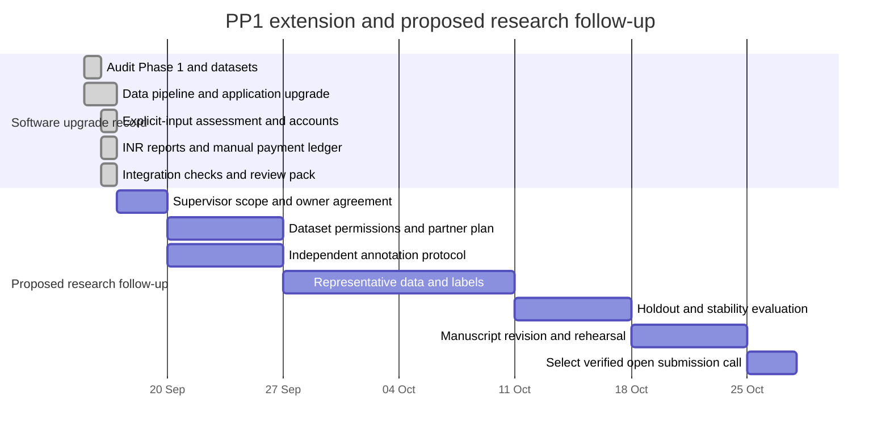

# Project planning, progress and risks

**Planning record prepared:** 16 September 2026. The Phase 1 source was supplied, but its original dated plan, review milestones, effort estimates and team assignments were not. This is an evidence-based comparison of software scope and a proposed follow-up schedule. It does not reconstruct an undocumented historical schedule.

## Phase 1 to Phase 2 comparison

| Work package | Evidence in supplied Phase 1 | Upgrade scope | Acceptance evidence |
|---|---|---|---|
| Application workflow | Landing page, borrower form, rule-based appraisal, JSON/PDF reports | Account-owned history/explanations, explicit-input policy assessment, all purposes, INR presentation and PDF charts | Auth/owner checks, missing-financial regression, requested-term tests and PDF inspection |
| Repayment recording | No persistent actual-agreement/payment ledger | Record manual agreement, dated payments and atomic CSV; preserve original assessment and source boundaries | Cent reconciliation, ownership, idempotency, dates, duplicate/conflict/rollback and rebuild-preservation tests |
| Data integration | Farm/dairy CSVs and agricultural price workbook | Integrate supplied accepted-loan archive and document import provenance | Manifest row counts/hashes and paginated records |
| Research analytics | Per-application TF-IDF/KMeans/LDA; questionable constructed numeric rows and mixed proxies | Analyze real imported records, retain source boundaries, report clustering quality and outcome cohorts | Analysis artifact, definitions and interpretation |
| Performance | Synchronous repeated parsing, fitting and PDF work | Cache reusable results, move expensive work out of interactive paths, add indexes/pool, defer scripts and lazy-load data | Repeatable timings and query-plan evidence |
| Chat | No HTTP chat API in baseline | Add a fast local evidence-based assistant | Chat contract, error handling and measured response latency |
| Review evidence | No paper, plan, test report or contribution log found in supplied folder | Provide audit, research draft, tests, results, plan, risks, SDG and viva material | Files in this folder and generated validation artifacts |
| Household outcome measurement | No linked baseline/follow-up data or validated import path | Add strict local CSV import and paired household/per-capita/business income analysis | `impact_outcomes.py`, header-only template, nine synthetic-fixture tests; no real observations supplied |

### Historical schedule variance

| Required comparison | Available evidence | Honest status |
|---|---|---|
| Phase 1 planned dates versus actual dates | Original plan not supplied | Cannot calculate date variance |
| Phase 1 planned features versus delivered features | Source code and topic image | Scope gaps recorded in the audit |
| Phase 2 planned features versus delivered features | Current user request, source and tests | Inspect the acceptance artifacts above |
| Team planned versus actual effort | No team timesheet or assignments supplied | Not established; complete the contribution record below |

## Dependency chart

The first section records the software-upgrade period. The remaining dates are **proposed planning dates**, not commitments from a partner, supervisor or venue. Move them after the team agrees resources and data access.

The chart's completed software tasks refer to the upgrade artifacts and their validation, not a completed field study or paper submission. Field follow-up duration must reflect actual loan terms and the chosen welfare outcome; it is not squeezed into the short manuscript schedule above. A paper can instead explicitly target the evaluated software contribution.

## Follow-up work packages and owners

| ID | Work | Depends on | Proposed owner role | Completion criterion |
|---|---|---|---|---|
| R1 | Agree research question and final claims | Delivered audit | Student lead + supervisor, names pending | Written scope and chosen primary outcome/contribution |
| R2 | Secure source permissions and partner data | R1 | Data steward, unassigned | Data agreement, field dictionary and consent basis |
| R3 | Label narrative sample independently | R1/R2 | Two annotators, unassigned | Annotation guide, agreement metric and adjudicated holdout |
| R4 | Evaluate temporal/generalization stability | R2/R3 | Analysis lead, unassigned | Fixed split, baselines, uncertainty and subgroup results |
| R5 | Evaluate usability and explanation comprehension | R1 | UX lead, unassigned | Approved protocol, real participant results and limitations |
| R6 | Revise paper and presentation | R4/R5 | All actual authors | Reproduced claims and supervisor review |
| R7 | Submit to an appropriate open venue | R6 | Corresponding author, unassigned | Genuine submission ID and acknowledgment |

## Risk register and adjustment evidence

| ID | Risk | Likelihood / impact | Mitigation or scope adjustment | Evidence / follow-up owner |
|---|---|---|---|---|
| D1 | Accepted-loan archive is not the target Indian microfinance population | High / high | Keep source/currency boundaries; restrict conclusions to exploratory portfolio methods | Manifest, paper limitations; research lead |
| D2 | Missing narratives or selective availability distort text findings | High / high | Report text coverage and text type; do not call generated context an authentic narrative | Data-quality/analysis artifact; data steward |
| D3 | No household baseline/follow-up measures | Certain / high | Remove achieved-poverty-impact claims; plan a separate welfare evaluation | Topic audit and SDG document; supervisor |
| D4 | Sampling and text availability change observed distributions | High / high | Document seed-42 uniform reservoir of 12,000 from 2,260,668 eligible rows; disclose that all 600 qualifying narratives are resolved historical loans | Import manifest and analysis settings; analysis lead |
| M1 | Arbitrary cluster IDs or mixed-unit proxies give misleading correlations | High in baseline / high | Use numeric variables with a clear meaning, analyze categorical cohorts, separate data sources | Baseline findings and delivered research module; analysis lead |
| M2 | Sentiment mistaken for repayment probability | High / high | Label heuristics and keep text interpretation out of autonomous loan decisions | UI explanations and methodology; product lead |
| M3 | Training and evaluation use the same observations | Medium / high | Treat current clustering metrics as internal quality only; add independent evaluation before predictive claims | Paper evaluation plan; analysis lead |
| T1 | Large archive exhausts memory or slows a request | High / medium | Stream import; persist results; bound query pages/model samples; keep model fitting off chat path | Import code, pool/index evidence and timing report; engineering lead |
| T2 | SQLite concurrency bottleneck under a larger deployment | Medium / medium | Bounded pooling, short transactions and measured workload; reassess database engine for real traffic | Schema/pool code and load checks; engineering lead |
| T3 | Optional OCR/model dependencies unavailable | Medium / medium | Explicit availability messages and a working text-input route | Negative tests and setup instructions; engineering lead |
| T4 | Private applicant information exposed through reports | Medium / high | Password-hashed accounts, owner checks, CSRF and on-demand reports; retention/deletion and production identity controls still need deployment work | Owner-isolation tests and operations guide; data steward |
| T5 | Unprovided sales/yields/costs mistaken for a forecast | High in baseline / high | Remove default financial extrapolations; annualize only explicit monthly revenue and costs; show provenance and missing values | Milk-business regression and rule trace; engineering lead |
| T6 | Manual payment error or duplicate | Medium / high | Unique references, idempotency, integer-paise schedules, atomic CSV, immutable initial agreement; correction UI remains future work | Ledger tests and operations guide; data steward |
| T7 | Currency conversion obscures population/units | Medium / high | Preserve source units internally; pin source/date for INR conversion; display price units and locality fallback; no risk transfer | Currency tests, FX config and explanation; analysis lead |
| P1 | Rubric paper-submission evidence cannot be produced by code | Certain / high | Supply a real draft and checklist; record submission only after an author submits | Submission checklist; corresponding author |
| P2 | Original team plan and contribution evidence absent | Certain / medium | Record this gap; obtain genuine historical records instead of inventing them | Table above and record below; student lead |

## Team contribution record

This upgrade was prepared with automated coding/documentation assistance. The actual student team must review it, reproduce results and record their own work. No student names or individual efforts have been assumed.

| Team member | Actual responsibility | Evidence (commit, analysis, test or document section) | Dates / effort | Reviewer |
|---|---|---|---|---|
| To be supplied | To be supplied | To be supplied | To be supplied | To be supplied |

During the viva, each member should demonstrate the part they understand, explain a design tradeoff and reproduce at least one relevant result. Merely assigning names to this table does not establish contribution.
